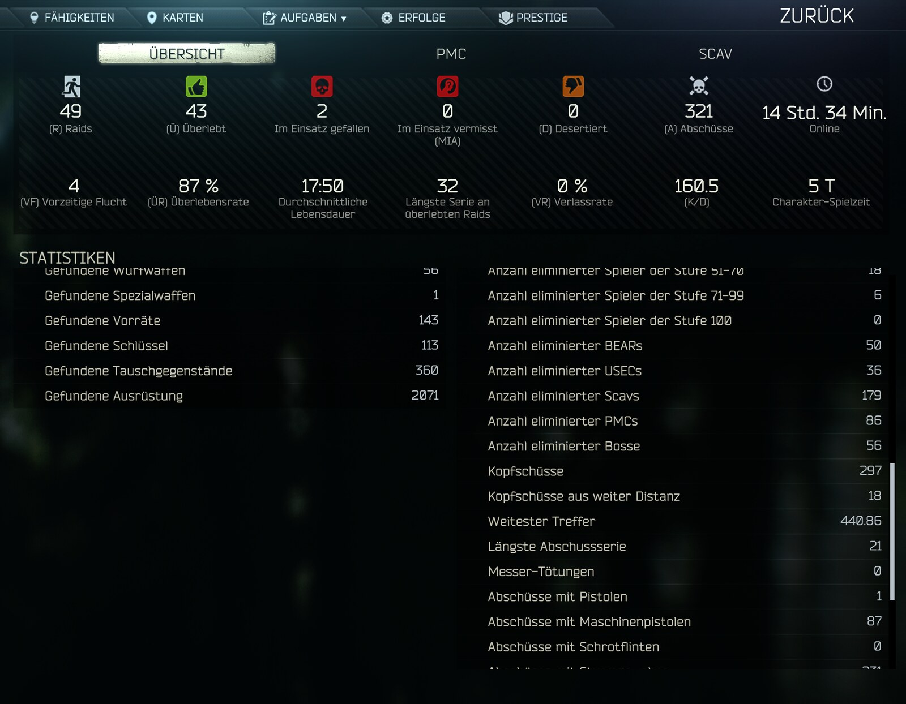

# Zielhilfe (aim assist)

A configurable single-player aim assist for SPT 4.1.6 (BepInEx client plugin): it nudges your own mouse movement toward enemy hit zones, with bullet-drop and lead compensation computed from the loaded round.

> **WARNING - single-player only. This is a cheat-like mod.**
>
> - Use it **only in offline SPT raids against AI bots**.
> - **Never** use it in live Escape from Tarkov or on any server with real players. That is cheating against real people and will get your account banned.
> - The mod reads enemy positions and armor, so it behaves like an aimbot-lite by design. The optional Enemy ESP (off by default) shows enemies through walls. The default "Soft Aim" never moves the camera on its own; it only bends the mouse movement you make yourself (see below).
> - The optional **AFK guard** (since 1.4.0, only active after you press its key) is a fully automated defense mode: it aims and fires on its own. Offline single player against bots only.

> **Upgrading to 1.3.0:** the F12 menu got a new first section, "0 Quick Setup" (see below). **None of your existing values are touched.** On the first start the mod only *reads* your settings: if they match Light, Medium or Strong exactly it shows that, otherwise "Strength" shows Custom. Your "Enabled" and Enemy ESP switches moved into the new section with their values.
>
> **Upgrading from 1.1.0:** version 1.2.0 renamed all settings to English. Your existing values are migrated automatically on the first start (the BepInEx log shows "Migrated N settings from the German names"); nothing needs to be re-entered. The combat recording folder is now `BepInEx/Zielhilfe-Recordings` (old `Zielhilfe-Aufzeichnung` folders are left untouched).



## How this mod was made (AI disclosure)

This mod was **programmed by Claude**, an AI assistant made by Anthropic.
**Kaan was the tester**.

I had a work accident a few years ago, and since then I can't move my right hand
precisely. It shakes. So I asked Claude for help, and this is what came out of it.
Over time it got more and more complex and better. After 2 months I'm giving it to
the public.

Kaan has no programming background, played with the mod
on SPT 4.1.6, reported what went wrong, and Claude fixed it. No human programmer
has reviewed the code. It is open source so anyone can check it — if you find a
bug, please open an [issue](https://github.com/Kaanori/spt-zielhilfe/issues).

## Requirements

- SPT 4.1.6 (EFT 0.16.9). BepInEx ships with SPT.

## Installation

1. Download `Zielhilfe-1.4.3.zip` from the [Releases](https://github.com/Kaanori/spt-zielhilfe/releases) page.
2. Extract it **into your SPT game folder** (the folder that contains `EscapeFromTarkov.exe`).
   The ZIP already has the right layout; the mod ends up in `BepInEx/plugins/`.
   On Windows, make sure "Extract All" does not add an extra subfolder.
3. Restart the game.

## Uninstall

Delete the mod's files from `BepInEx/plugins/` (settings: `BepInEx/config/` for client mods) and restart the game.

## Features

### Targeting

- **Enemy filter.** By default only bots that the game itself considers hostile to you are used (the game's own `BotsGroup` / `IsPlayerEnemy` logic: side, karma, boss loyalty, friend/warn/enemy types). Friendly scavs are ignored until they turn hostile. Scavs, PMCs and bosses/guards can additionally be excluded individually.
- **Range and selection.** Enemies beyond a configurable range are ignored. The current target is kept until another enemy is clearly better (a switch margin in pixels), which stops the assist from flickering between two enemies standing next to each other.
- **Line of sight.** Enemies behind walls are skipped. The visibility ray uses the head box (or body point) that is actually reachable. By default the ray only checks the physics layers that bullets use, so invisible visibility-control cubes do not block it.
- **Shoot-through handling (glass, fences, foliage).** Glass, wire mesh, grates, tall grass and similar are not treated as obstacles. The decision comes from the game's own material and penetration data for the collider that was hit, evaluated for your currently loaded cartridge (penetration vs. material level, plus chance values). Other materials (wood, sheet metal, plastic ...) count as passable if the computed probability is above a threshold. Bodies never count as passable.
- **Zone choice by armor ("Choose zone by armor").** For each enemy the worn armor is queried and the zone with the best expected result is chosen, using the same calculation as the game (shot match plus penetration chance from armor class, durability and the cartridge's penetration), taking the enemy's facing into account (front/back plates, sides). Zones are weighted: head 1.0, torso 0.6, pelvis 0.25 (legs lower still). Zones can be individually allowed or disallowed; pelvis and legs act only as fallbacks when head and torso are covered or cannot be penetrated.
- **Head boxes.** The head in EFT consists of eight hit boxes. The mode "Visible" checks each box individually and picks the first one with a free line of sight (order of preference: head centre, face, jaw, parietal/top, back of head, ears, neck front, neck back; with armor-based selection the least armored free box comes first). Alternatively a fixed box can be forced. Inside the box you choose the aim height (0 = bottom, 1 = top).
- **Fallback to the chest** when no head box is free (only without armor-based zone choice).

### Aiming / Soft Aim (default mode)

Three modes exist ("Assist type"):

1. **SoftAimMouse (default, recommended)** - real soft aim. The assist never turns the view by itself on its own initiative. It intercepts your mouse input (a Harmony patch on the game's move/look input translator) and bends it slightly toward the target while your weapon's real bullet line is close to a hit zone. Details:
   - **Capture radius.** Measured from the *edge* of a hit zone as an angle, either as a distance at the enemy in metres (converted with the enemy's distance, with a minimum and maximum angle) or as a fixed angle in degrees. Effect fades to zero toward the radius edge.
   - **Attraction (weight).** Result = w x target vector + (1 - w) x mouse movement. The assist never reverses your movement: pulling away from the target always works, and the pull relaxes when your own movement already reaches the target point and fades to zero toward the zone centre, so nothing snaps or sticks.
   - **Friction.** Slows the part of your movement that goes across or away from the target while inside the radius.
   - **Correction limit.** A cap in degrees per second (frame-rate independent) on attraction plus friction.
   - **Magnet (hold without mouse).** The only part that also acts while the mouse is still: it slowly pulls the actual bullet line back to the aim point to counter sway and recoil. It uses the real flight direction of the bullet, so recoil is already included. It yields to your own mouse movement (decay when you steer faster than a threshold, measured on screen including scope zoom) and has its own catch-up time.
   - **Catch-up boost.** When the bullet line enters the capture area (also right after a target change) the magnet may pull harder for a short time. It aborts when you pull away.
   - **Target tracking for moving targets.** Turns along with a moving target, but only the *difference* between the target line's angular velocity and your own turn rate (both smoothed), so it adds nothing if you already track. It is limited to the capture area and releases when you pull away from the zone.
   - **Release logic.** The assist sums up how far you move the mouse away from the wanted zone; above a threshold magnet, follow-through and boost switch off until the sum falls again. It re-engages after the mouse has been calm for a short time.
   - **Zoom scaling.** Corrections are in degrees, which look bigger through a scope; optionally the boost, follow-through and attraction caps are divided by the magnification.
   - **Weapon classes.** Pistol, SMG, assault rifle/carbine, marksman/sniper rifle, shotgun and machine gun can each have their own capture/magnet values ("1c" to "1h"). Marksman/sniper and shotgun ship with their own values enabled. Grenade launchers are excluded.
   - **Recoil compensation (optional).** Subtracts newly added weapon recoil from your mouse movement while firing, independent of a target. Off by default.
2. **LegacySoftAim (legacy)** - every frame a capped turn toward the target, independent of the mouse. Uses the "9 Legacy Modes" settings.
3. **LegacyLockOn (legacy)** - the view direction is set onto the target every frame. Uses the "9 Legacy Modes" settings.

The legacy modes also have: own-mouse priority (the assist lets go when you turn fast and stays off for a short time afterwards), a dead zone, tracking of moving targets, muzzle re-regulation (measures where the *muzzle* really points and regulates the remaining offset away), and hip-fire offset compensation. These settings are hidden unless "Advanced settings" is enabled in the F12 menu.

### Ballistics: lead and bullet drop

- **Bullet drop.** The aim point is raised by the amount the bullet falls on the way to the target. The trajectory is computed step by step, replicating the game's own player-bullet solver (`TrajectoryCalculator.NextForPlayer`, using the game's G1 drag function with the cartridge's mass, diameter, ballistic coefficient and initial speed times the weapon's speed factor). The drop is computed against the distance your sight is currently zeroed to. If the muzzle is what gets aimed (Soft Aim aims the bullet line), the zero's built-in elevation is already cancelled and the full drop is applied; if the sight is aimed, only the remainder is added.
- **Lead (target lead).** For moving enemies the aim point is moved to where the enemy will be when the bullet arrives, using the computed flight time. The enemy's velocity is smoothed (with a lower bound independent of flight time), only applied above a minimum speed, capped in metres, optionally horizontal only, and reduced when the enemy changes direction sharply. An additional term compensates your own frame latency (one frame ahead by default).
- **Fire point.** Angles are computed from the weapon's fire point (muzzle), not the camera, so parallax at close range is accounted for. Consequence: at close range the crosshair can sit visibly beside the enemy while the shot lands.

### Visibility and obstacles

See "Line of sight" and "Shoot-through handling" above. Hit-point checks use the game's ballistic colliders, not guessed lists.

### Enemy ESP (optional, off by default)

An overlay that marks enemies on screen, including through walls. It is **off by default**; enable it with "Enemy ESP" in section "0 Quick Setup" or with the toggle hotkey (default Insert). Offline single-player only.

- **Per-type filters.** PMC USEC, PMC BEAR, Scav, Boss, Guard/Follower, Raider, Rogue, Cultist, Other - each can be shown or hidden and has its own colour. With "Hostile enemies only" (default) the aim assist's hostility logic is used, so allied/friendly bots are left out exactly as for the aim assist. Bosses are labelled with their name.
- **Styles.** Full box, corner box or a small marker; optional type/name label, distance, vertical health bar (from the bot's health controller) and a head dot. Labels and line thickness scale with the screen height (identical look at 1080p and 4K).
- **Visible vs. occluded.** A throttled line-of-sight check (default 8 per second per enemy, at most 6 enemies per frame, bullet-relevant layers only, glass/fences count as see-through) switches between two opacity values, or hides occluded enemies entirely.
- **Far enemies** beyond a configurable distance get only a small marker and the distance.
- **Only while the aim assist is active** (optional): the ESP shows only while the assist is active, i.e. while you hold its hotkey when "When active" is HoldKey.
- **Correct placement.** It draws with the camera that renders the picture (`Camera.main`, "FPS Camera"), converts through viewport coordinates (0..1) and multiplies by the window size, so it stays correct with resolution scaling and FSR upscaling (e.g. render 2560x1440 -> output 3840x2160); it uses the non-jittered projection so upscaler jitter does not shake the boxes. It is hidden in the inventory/menus, after death, in third person and - by default - while aiming through a magnifying scope (the lens image has its own camera and field of view, so markers could not line up there; iron sights and red dots are fine).
- **Cost.** No per-frame allocations (entries, strings and ray buffers are reused); the enemy list refreshes 4 times per second. Estimated about 0.05-0.3 ms per frame for a typical raid (5-30 bots in range); when disabled only a key check runs.

### AFK guard (emergency break, since 1.4.0)

An automated defense mode for single player, for when you have to leave the keyboard for a moment in the middle of a raid. Find a hidden spot, press **Pause** (Pause/Break key) and walk away; press **Pause** again when you are back. Nothing happens until you press the key.

While it is on:

- **You stay where you are.** The guard never moves your character; it only turns the view and works the trigger. You can still use your keys, but the guard keeps aiming until you switch it off.
- **It shoots back at attackers.** Anyone who hits you, or whose bullet passes within about 1.2 m of you, counts as an attacker for 30 seconds (configurable) and is engaged at any distance up to "2 Target / Range in meters" - even a bot the game does not list as hostile, and even if its type is excluded in "3 Exclusions". Hits are remembered even while the guard is off, so switching it on right after being shot still knows the shooter.
- **It shoots every hostile bot within 25 m** (configurable) that has a clear line of fire. Hostility and the exclusions in "3 Exclusions" work exactly as for the aim assist.
- **Priority:** attackers first, then the nearest. The target is sticky (since 1.4.1): it is kept while it lives and is an attacker or in range, even when it ducks behind cover for a moment ("Keep target while hidden"). An attacker is never swapped for a non-attacker; it switches only when a new attacker appears while the target is not one, or when another one in the same group is less than half as far away.
- **Aiming** uses the same aim point as the aim assist (zone by armor or your "Aim at" choice, free head box, lead and bullet drop) and lays the real bullet line onto it. The view turns smoothly, capped by "Max turn rate".
- **Firing** only happens while the bullet line is within "Aim tolerance" of the aim point: full-auto weapons fire bursts ("Burst length", "Burst pause"), semi-auto and bolt-action weapons fire single shots. It aims down sights while engaging (optional) and lowers the weapon 3 s after the last target.
- **Reloading:** when the weapon is empty it reloads exactly like your reload key (a magazine from your rig/pockets). If nothing can be loaded it stops firing and shows "AFK guard: out of ammo".
- **It always lets go of the trigger** when you switch it off, when the target is lost, while an inventory/menu is open or the game is paused, and it switches itself off when you die or the raid ends.
- A notification appears when it switches on/off or needs you, and an orange status line at the top of the screen shows what it is doing (both can be turned off with "Show notice"). The normal aim assist pauses while the guard runs.

### Hotkey

One configurable key (default Left Alt) used only when "When active" is set to hold or toggle (and for the legacy modes). It can be a keyboard key or a mouse button. With the default setting ("Always") no key is needed.

## Controls

| Control | Default | Effect |
|---|---|---|
| "Hotkey" (F12 menu) | Left Alt | Hold or toggle the assist, depending on "When active" (Soft Aim) or "When it pulls" (legacy modes). Not needed in the default always-on mode. |
| "Toggle hotkey" (section 6 ESP) | Insert | Switches the Enemy ESP on/off during a raid. |
| "Toggle hotkey" (section 7 AFK Guard) | Pause | Switches the AFK guard (automatic defense while you are away) on/off during a raid. Pause is not used by the game or by the other mods in this pack (F9 and End are). |
| F12 (BepInEx Configuration Manager) | - | Opens the settings, starting with "0 Quick Setup"; tick "Show all settings" there for everything, and enable "Advanced settings" (in F12) to see the legacy sections. |

There are no other hotkeys. The mod also needs no extra overlay.

## Settings

### Quick Setup (start here)

The first section of the F12 menu, "0 Quick Setup", is all most people need:

| Entry | What it does | Default |
|---|---|---|
| Enabled | Master switch. Off = the mod does nothing. | on |
| Strength | **Light / Medium / Strong** set a matching group of values in sections 1b and 1c-1h. **Custom** = your own values; it is selected automatically as soon as you change one of those values by hand (choosing Custom yourself changes nothing). | Medium |
| Aim at | **Smart** = head or torso, whichever is likely to hurt more given the enemy's armor. **Head** = head (torso only when the head is covered). **Body** = torso. **Custom** = your own zone settings, selected automatically when you change them by hand. | Smart |
| Enemy ESP | Boxes and labels for enemies, also through walls. Toggle during a raid with the hotkey in "6 ESP" (default Insert). | off |
| Show all settings | Off = F12 shows only this section plus a few essentials (Hotkey, When active, ADS only, recoil compensation, Range in meters, the three exclusions, ESP toggle hotkey and maximum distance, AFK guard hotkey). On = every setting. Nothing is reset either way. After ticking it the list refreshes by itself; if it does not, close and reopen F12. | off on a fresh install, **on** for existing installations |

What the three Strength levels set (Medium = the values the mod always shipped with):

| Setting (section 1b) | Light | Medium | Strong |
|---|---|---|---|
| Radius in meters from zone edge | 0.5 | 0.75 | 1.0 |
| Pull strength (weight) | 0.3 | 0.5 | 0.75 |
| Friction | 0.15 | 0.3 | 0.45 |
| Hold without mouse (magnet), max degrees per second | 4 | 10 | 14 |
| Target tracking share | 0.4 | 0.7 | 0.9 |
| Capture boost maximum degrees per second | 20 | 40 | 60 |
| Maximum correction (degrees per second) | 60 | 120 | 200 |
| 1f DMR and Sniper: radius / pull / friction / magnet | 0.35 / 0.3 / 0.2 / 4 | 0.5 / 0.5 / 0.4 / 10 | 0.7 / 0.75 / 0.55 / 14 |
| 1g Shotgun: radius / pull / friction / magnet | 0.7 / 0.3 / 0.15 / 4 | 1.0 / 0.5 / 0.3 / 10 | 1.4 / 0.75 / 0.45 / 14 |

Pistol, SMG, Assault Rifle and Machine Gun use the general values ("Use own values" off); DMR/Sniper and Shotgun keep their own values switched on, as they always did, scaled with the level. Target tracking and capture boost of those two classes follow the general ones. Even "Strong" stays mouse-driven: the assist bends your own movement and never aims for you.

"Aim at" writes: Smart = Choose zone by armor on, Body part Head, zones Head and Torso allowed; Head = armor choice off, Body part Head, Head and Torso allowed; Body = armor choice off, Body part Chest, only Torso allowed (Pelvis and Legs stay a last resort in all three).

If you edit the cfg file by hand while the game is closed, a Strength/Aim-at value that no longer matches your numbers is corrected to what the numbers say (your numbers are never changed).

Values were taken from the source. Entry names are shown exactly as in the F12 menu.

### 1 General

The master switch "Enabled" now lives in "0 Quick Setup".

| Entry | Meaning | Default | Range |
|---|---|---|---|
| Hotkey | Key or mouse button for hold/toggle activation. | LeftAlt | any KeyCode |

### 1b Soft Aim (mouse) (main section)

| Entry | Meaning | Default | Range |
|---|---|---|---|
| Assist type | Mode: SoftAimMouse, LegacySoftAim, LegacyLockOn. | SoftAimMouse | enum |
| When active | When active: Always (always), HoldKey (hold key), ToggleKey (toggle). Always is harmless since nothing happens without mouse movement. | Always | enum |
| Only when aiming down sights (ADS) | Only when aiming down sights. Off = also from the hip (calculated with the weapon's bullet direction, not the camera). | off | on/off |
| Choose zone by armor | Choose the hit zone by armor and enemy facing (see Features). Off = fixed body part from "9 Legacy Modes - Target". | on | on/off |
| Allowed zone: Head | Allow pulling onto the head. | on | on/off |
| Allowed zone: Torso | Allow pulling onto the torso. | on | on/off |
| Allowed zone: Pelvis | Allow pelvis. Off = pelvis only as fallback. | off | on/off |
| Allowed zone: Legs | Allow legs. Off = legs only as last fallback. | off | on/off |
| Enemies only | Only enemies according to the game's own hostility logic. "3 Exclusions" applies additionally. | on | on/off |
| Recoil compensation horizontal (%) | Subtracts newly added sideways weapon recoil from your mouse movement while firing, independent of any target. 0 = off (you probably already pull against recoil; both together would over-correct). | 0 | 0-100 |
| Recoil compensation vertical (%) | Same for the vertical component. | 0 | 0-100 |
| Radius type | How the capture radius is specified: Meters (distance at the enemy, converted by distance) or Degrees (fixed angle). | Meters | enum |
| Radius in meters from zone edge | Capture radius in metres beyond the zone edge (Meters mode). | 0.75 | 0.05-5 |
| Maximum radius (degrees) | Upper angle limit for close range (Meters mode). | 12 | 1-30 |
| Minimum radius (degrees) | Lower angle limit for long range (Meters mode). | 1 | 0.05-5 |
| Radius in degrees | Fixed radius angle (Degrees mode), measured from the zone edge. | 3 | 0.2-15 |
| Pull strength (weight) | Weight w of the pull toward the target inside the radius. 0 = off, 1 = movement points fully at the target. | 0.5 | 0-1 |
| Friction | Friction on movement across/away from the target inside the radius. 0 = off. | 0.3 | 0-1 |
| Maximum correction (degrees per second) | Cap for attraction plus friction, in degrees per second. | 120 | 1-600 |
| Hold without mouse (magnet), maximum degrees per second | Magnet strength: pulls the bullet line back to the aim point even when the mouse is still. 0 = off. | 10 | 0-60 |
| Magnet pull time in seconds | How fast the magnet removes a remainder (about two thirds gone after this time). Smaller = firmer. | 0.05 | 0.02-1 |
| Magnet yields to own mouse above x degrees per second (screen) | Above this own on-screen turn rate the magnet no longer holds against your movement. 0 = off. | 10 | 0-100 |
| Target tracking share | Share of the follow-through (target line turn rate minus your own turn rate). 0 = off. | 0.7 | 0-1 |
| Target tracking maximum degrees per second | Cap for the follow-through. | 60 | 0-200 |
| Tracking: do not count assist rotation as own | Do not count the rotation made by the assist itself as your own when comparing turn rates (so it can follow walking enemies at full speed). | on | on/off |
| Capture boost duration (s) | Duration of the capture boost after the bullet line enters the capture area. | 0.3 | 0-1 |
| Capture boost maximum degrees per second | Magnet cap during the boost. 0 = off. | 40 | 0-150 |
| Divide caps by zoom | Divide boost, follow-through and attraction caps by the scope magnification. The magnet itself is not divided. | on | on/off |
| Release after travel (degrees) | If you move the mouse this far (summed) away from the wanted zone, magnet, follow-through and boost switch off until the sum halves. 0 = off. | 2 | 0-10 |
| Re-engage after release (s) | After a release by your own movement, re-engage once the mouse has been calm for this long. 0 = off. | 0.06 | 0-0.5 |

### 1c to 1h Class ... (per weapon class)

Sections: "1c Class Pistol", "1d Class SMG", "1e Class Assault Rifle and Carbine", "1f Class DMR and Sniper", "1g Class Shotgun", "1h Class Machine Gun". Each has the same entries; the class values replace the general values from "1b" only when "Use own values instead of general" is on.

| Entry | Meaning | Default (all classes unless noted) | Range |
|---|---|---|---|
| Use own values instead of general | Use this class's own values instead of "1b". | off; **on** for DMR/sniper and shotgun | on/off |
| Radius in meters from zone edge | As in 1b. | 0.75 (DMR/sniper 0.5, shotgun 1.0) | 0.05-5 |
| Pull strength (weight) | As in 1b. | 0.5 | 0-1 |
| Friction | As in 1b. | 0.3 (DMR/sniper 0.4) | 0-1 |
| Hold without mouse (magnet), maximum degrees per second | As in 1b. | 10 | 0-60 |
| Magnet pull time in seconds | As in 1b. | 0.05 | 0.02-1 |
| Target tracking share | As in 1b. | 0.7 | 0-1 |
| Target tracking maximum degrees per second | As in 1b. | 60 | 0-200 |
| Capture boost duration (s) | As in 1b. | 0.3 | 0-1 |
| Capture boost maximum degrees per second | As in 1b. | 40 | 0-150 |

### 2 Target (targeting)

| Entry | Meaning | Default | Range |
|---|---|---|---|
| Range in meters | Enemies farther away are ignored. | 930 | 10-1500 |
| Body part | Preferred body part: Head, Chest, Pelvis, Legs. With armor-based zone choice it only determines the point where visibility is checked. | Head | enum |
| Head hitbox | Which head box to aim at: Visible (first free box), HeadCenter, Face, Jaw, Skull. | Visible | enum |
| Height within head box | Aim height inside the box (0 bottom, 0.5 middle, 1 top), scaled to the box's real height. | 0.72 | 0-1 |
| Fall back to chest when head is covered | Aim at the chest when no head box is free (only without armor-based zone choice). | on | on/off |
| Clear line of sight only | Skip enemies behind walls. | on | on/off |
| Ignore shoot-through obstacles | Glass, mesh, grates, tall grass etc. do not count as obstacles (game's material/penetration data). | on | on/off |
| Shoot-through from probability | Probability above which other materials count as passable for your loaded cartridge. | 0.5 | 0-1 |
| Check only layers bullets travel on | Check only physics layers bullets use for the line of sight. | on | on/off |
| Target switch margin (pixels) | A different enemy must be better by this many pixels before the target switches. 0 = always the nearest. | 40 | 0-300 |

### 3 Exclusions (who to skip)

| Entry | Meaning | Default |
|---|---|---|
| Scavs | Ignore scavs. | off |
| PMCs | Ignore PMCs. | off |
| Bosses and guards | Ignore bosses and guards. | off |

### 5 Lead (lead and bullet drop)

| Entry | Meaning | Default | Range |
|---|---|---|---|
| Compensate bullet drop | Compensate bullet drop against the sight's zero distance. | on | on/off |
| Enabled | Lead on/off. Off = always aim directly at the target. | on | on/off |
| Factor | Multiplier on the computed flight time (1 = unchanged). Raise it if you shoot behind. | 1 | 0-3 |
| Maximum (meters) | Cap on the lead distance. | 4 | 0.5-20 |
| Only above (m/s) | Minimum enemy speed for lead. | 1.2 | 0-5 |
| Smoothing (seconds) | Averaging time for the enemy's measured velocity. | 0.15 | 0.02-1 |
| Minimum smoothing (seconds) | Lower bound for the smoothing, independent of flight time. | 0.06 | 0-0.5 |
| Compensate frame delay (frames) | Compensate your own frame delay by leading this many frames. 0 = off. | 1 | 0-3 |
| Horizontal movement only | Ignore vertical motion (walking bob). | on | on/off |
| Reduce on direction change | Reduce the lead when the enemy turns sharply. 0 = off, 1 = lead vanishes on a hard turn. | 0.7 | 0-1 |

### 6 ESP (enemy overlay, off by default)

The on/off switch "Enemy ESP" now lives in "0 Quick Setup".

| Entry | Meaning | Default | Range |
|---|---|---|---|
| Toggle hotkey | Toggles "Enemy ESP" (in "0 Quick Setup") during the raid. None = no hotkey. | Insert | any KeyCode |
| Maximum distance (m) | Enemies farther away are not drawn. | 300 | 10-1500 |
| Hostile enemies only | Only bots hostile to you (same logic as the aim assist). Off = every living bot. | on | on/off |
| Only while the aim assist is active | Draw only while the aim assist is active (e.g. hotkey held with HoldKey). | off | on/off |
| Draw while aiming through a scope | Draw even through magnifying scopes (positions will not match the lens image). | off | on/off |
| Visibility checks per second | Line-of-sight re-check rate per enemy. 0 = never check (all count as visible). | 8 | 0-30 |
| Show: PMC USEC / PMC BEAR / Scav / Boss / Guard / Follower / Raider / Rogue / Cultist / Other | One switch per enemy type. | all on | on/off |

### 6b ESP Appearance

| Entry | Meaning | Default | Range |
|---|---|---|---|
| Draw style | Box, CornerBox or Marker. | CornerBox | enum |
| Show type label | Type text above the box. | on | on/off |
| Show boss names | Bosses show their name instead of the type. | on | on/off |
| Show distance | Distance in meters below the box. | on | on/off |
| Show health bar | Vertical health bar left of the box. | on | on/off |
| Show head dot | Small dot on the head. | off | on/off |
| Draw occluded enemies | Off = only enemies in line of sight are drawn. | on | on/off |
| Opacity when visible | Opacity for enemies in line of sight. | 1 | 0.05-1 |
| Opacity when occluded | Opacity for enemies behind cover. | 0.45 | 0.05-1 |
| Simplify beyond (m) | Farther enemies get only a marker and the distance. 0 = never. | 150 | 0-1500 |
| Label size (% of screen height) | Font size relative to the screen height. | 1.5 | 0.8-4 |
| Line thickness (pixels at 1080p) | Scaled with the screen height. | 1.5 | 1-6 |
| Marker size (% of screen height) | Size of the small marker / head dot. | 0.9 | 0.3-3 |
| Color: PMC USEC / PMC BEAR / Scav / Boss / Guard / Follower / Raider / Rogue / Cultist / Other | One colour per enemy type. | blue / red / yellow / magenta / orange / cyan / violet / lime / grey | colour |

### 7 AFK Guard (automatic defense, only after pressing its key)

Only "Toggle hotkey" is shown while "Show all settings" is off.

| Entry | Meaning | Default | Range |
|---|---|---|---|
| Toggle hotkey | Press once in a raid to switch the guard on, again to switch it off (the only off switch besides death/raid end). None = disabled. | Pause | any KeyCode |
| Range (m) | Hostile bots closer than this are engaged even if they have not attacked you. | 25 | 5-150 |
| Remember attacker (s) | How long someone who hit you or shot close past you stays an attacker. | 30 | 0-300 |
| Keep target while hidden (s) | The current target is kept this long after the line of fire is blocked; only then another target is chosen. | 0.75 | 0-3 |
| Max turn rate (deg/s) | How fast the view may turn towards a target. | 360 | 30-1080 |
| Aim tolerance (cm) | Fires only while the bullet line is this close to the aim point (at the target's distance). A full-auto burst stops when it drifts off more than 3x this (at least 1.5 degrees). | 10 | 2-50 |
| Burst length (s) | Full-auto/burst weapons: trigger time per burst. | 0.3 | 0.05-2 |
| Burst pause (s) | Pause after a burst, or between two single shots. | 0.25 | 0.05-2 |
| Aim down sights | Aim down sights while engaging. | on | on/off |
| Auto reload | Reload by itself when empty (like the reload key). Off = only a notice. | on | on/off |
| Show notice | Game notifications and the status line at the top of the screen. | on | on/off |

### 8 Diagnostics (diagnostics, off by default)

| Entry | Meaning | Default | Range |
|---|---|---|---|
| Diagnostics to log | Writes diagnostic lines to the BepInEx log (plus a shot line and hit line per own shot and impact analysis lines in Soft Aim). For troubleshooting only. | off | on/off |
| Diagnostics interval in seconds | Interval of the diagnostic line; 0 = every frame (the log grows fast). | 1 | 0-5 |
| Combat recording | Records every engagement frame by frame to disk (see below). | off | on/off |
| Recording limit per raid (MB) | Size cap per raid. | 200 | 10-5000 |
| Recording: keep only the last x raids | Older raid folders are deleted when a new raid starts. | 20 | 1-500 |
| Fight starts when an enemy sees you, up to x meters | Distance up to which an enemy that has you as a target and sees you starts an engagement. | 150 | 10-1000 |

### 9 Legacy Modes (legacy modes, only visible with "Advanced settings")

Used only when "Assist type" is LegacySoftAim or LegacyLockOn (except where noted).

| Section | Entry | Meaning | Default | Range |
|---|---|---|---|---|
| 9 Legacy Modes - General | When it pulls | HoldKey / ToggleKey / Always. | HoldKey | enum |
| 9 Legacy Modes - Target | Field of view (pixels) | Max. distance of an enemy from screen centre in pixels. | 61 | 10-600 |
| 9 Legacy Modes - Target | Field of view (degrees) | Same as an angle (zoom independent, preferred). 0 = use pixels. | 3 | 0-30 |
| 9 Legacy Modes - Target | Aim angle from fire point instead of camera | Compute the aim angle from the fire point instead of the camera. | on | on/off |
| 9 Legacy Modes - Movement | Pull speed | Pull speed toward the target (1/s, frame-rate independent). | 60 | 2-200 |
| 9 Legacy Modes - Movement | Soft aim maximum degrees per second | Cap in LegacySoftAim. | 80 | 10-600 |
| 9 Legacy Modes - Movement | Dead zone (degrees) | No further correction below this deviation. | 0.05 | 0-1 |
| 9 Legacy Modes - Movement | Own mouse has priority | Assist lets go when you turn fast. | on | on/off |
| 9 Legacy Modes - Movement | Priority above x degrees per second | Own turn rate that triggers the release. | 50 | 5-400 |
| 9 Legacy Modes - Movement | Then do not pull for x seconds | Time the assist stays off after your last turn. | 0.25 | 0-2 |
| 9 Legacy Modes - Movement | Track moving targets | Follow-through strength (1 = lag fully removed). | 1 | 0-1.5 |
| 9 Legacy Modes - Movement | Tracking smoothing (seconds) | Averaging time of the measured turn rate. | 0.08 | 0.02-0.5 |
| 9 Legacy Modes - Movement | Target tracking maximum degrees per second | Safety cap for the follow-through. | 150 | 10-400 |
| 9 Legacy Modes - Recoil | Compensate recoil | Shift the view so the muzzle (not the camera) points at the target; ADS only. 1 = full. | 0.8 | 0-1 |
| 9 Legacy Modes - Recoil | Smoothing (seconds) | Smoothing of weapon animation jitter. | 0.04 | 0.005-0.3 |
| 9 Legacy Modes - Recoil | Correct muzzle | Measure where the muzzle really points and regulate the remainder away (closed loop). | on | on/off |
| 9 Legacy Modes - Recoil | Correction speed | Speed of that regulation (1/s). | 6 | 0-30 |
| 9 Legacy Modes - Recoil | Correction maximum (degrees) | Cap of the accumulated correction. | 2 | 0.1-8 |
| 9 Legacy Modes - Recoil | Maximum (degrees) | Safety cap of the recoil compensation. | 3 | 0.5-10 |
| 9 Legacy Modes - Recoil | Compensate from hip | Hip-fire offset compensation (0 = none, 1 = full). | 1 | 0-1 |
| 9 Legacy Modes - Recoil | Hip maximum (degrees) | Cap for hip compensation; if the offset exceeds twice this, nothing is compensated. | 8 | 0-20 |

## Compatibility

- Works standalone. Requires only **SPT 4.1.6** and BepInEx (which SPT ships with). The F12 menu needs the BepInEx Configuration Manager (normally already part of an SPT install).
- It hooks the game's mouse-input translator (look axes) and observes shots and hits (own shots, hit callbacks, bullet collisions) with Harmony. These hooks are resolved by method reference, so a game update that changes the signatures fails at load instead of misbehaving.
- **Auto Ranging / automatic zero.** Bullet-drop compensation is computed against the zero distance the sight currently reports. If another mod sets the zero to the target distance automatically, there is little drop left to compensate; the code accounts for this (it only applies the part not already covered by the zero).
- **Scopes / FSR.** The mod works from the aim camera and the active scope's magnification. Settings in degrees are scaled by the magnification where documented ("Divide caps by zoom"). Behaviour with third-party scope or FSR/upscaling mods has not been verified.
- **SAIN.** The recording reads SAIN's bot state via reflection if SAIN is present (no hard dependency); this only matters when the recording is enabled.
- **Other aim/recoil mods.** Not tested. Using another mod that also modifies mouse look or recoil together with "Recoil compensation" may over-correct.
- **Fika (multiplayer coop): not tested.**

## Recording / diagnostics

Both are **off by default**.

- **Diagnostics to log** adds periodic status lines (interval configurable) and per-shot / per-hit lines to the BepInEx log. Meant for troubleshooting only; with an interval of 0 the log grows quickly.
- **Combat recording** records each engagement frame by frame into `BepInEx/Zielhilfe-Recordings/<date>-<map>/`, one gzip file (JSON Lines) per engagement: your own state, the mouse input with all correction components, enemies with hit zones, armor and AI intent, shots and hits. It writes from a background thread. An engagement starts when a target is in the capture area, you fire, you are hit, or an enemy that targets you sees you within the configured distance; it ends 4 s after the last such activity (1 s before the start is included). The size per raid and the number of kept raid folders are capped; older raid folders in that directory are deleted automatically. The format is meant for offline analysis and tuning.
- Per-shot impact analysis (where the bullet landed relative to the aim point) runs whenever either of the two switches is on; with both off it does nothing.

## Known limitations

- Single-player (offline) SPT only; not tested with Fika or any multiplayer setup.
- The mouse interception works on the game's look-axis input; If the hook fails, the log shows an error and Soft Aim stays off.
- The legacy modes (LegacySoftAim, LegacyLockOn) are kept for compatibility and are less refined; they can feel sticky or rigid and need their own tuning.
- The default capture, magnet and follow-through values were tuned with offline simulations of recorded fights and one player's mouse habits; they may need adjusting for other mice, sensitivities and frame rates.
- In the legacy modes, large hip-fire offsets (weapon lowered or being raised) are deliberately not compensated.
- Very low frame rates make the magnet unstable (very short catch-up times become jittery below about 30 fps).
- Armor-based zone choice depends on the game's armor data and the worn gear; heavily modded armor or ammunition systems may give unexpected zone choices.
- Grenade launchers are not supported.
- **AFK guard limits:** it does not move, take cover, heal, throw grenades, switch weapons or fix weapon malfunctions (it stops firing and shows "weapon malfunction - fix it yourself"). It only sees bots that are in its range or that shot at you; an enemy sneaking up from behind beyond the range is only noticed once it shoots. A bot whose bullet passes close to you while shooting at someone else also counts as an attacker. Being hit by explosions or melee counts as a hit from that bot. It cannot help if your position is bad - pick a corner with few approaches.
- Fences, foliage and other deviating materials can still deflect bullets even when counted as passable.
- The JSON field names inside the combat recordings are German (see `AUFZEICHNUNG-FORMAT.md` in the source); everything else is English.

## Building from source

Needs the .NET 10 SDK and an SPT 4.1.6 installation to build against.

```bash
./build.sh             # Linux: build only
./build.sh --install   # build and copy into the game folder
```
```powershell
.\build.ps1            # Windows
.\build.ps1 -Install
```

The game folder is set in `Directory.Build.props` (Windows default `C:/SPT`)
or via the environment variable `SPT_DIR`.

## Support

Bugs and questions: [GitHub issues](https://github.com/Kaanori/spt-zielhilfe/issues).

## License

MIT — see [LICENSE](https://github.com/Kaanori/spt-zielhilfe/blob/main/LICENSE).
